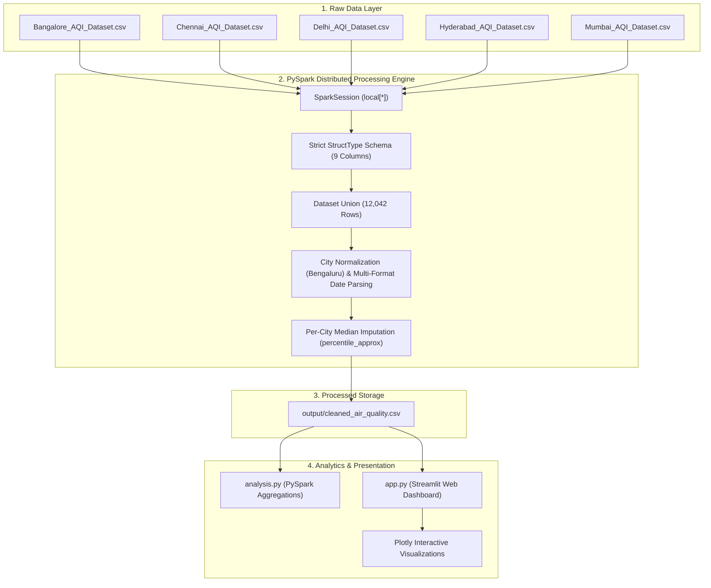

# 🌍 Air Quality Analysis using Apache Spark & PySpark

A final-year Big Data engineering and analytics project performing distributed data cleaning, statistical aggregation, and interactive visualization on historical air quality data across five major metropolitan Indian cities: **Bengaluru, Chennai, Delhi, Hyderabad, and Mumbai**.

---

## 👥 Project Team & Submission Details (Editable Placeholders)

- **Student Name(s)**: `[Student Name 1, Student Name 2]`
- **Roll Number(s)**: `[Roll Number / USN / Registration ID]`
- **Degree / Course**: `B.Tech / B.E. in Computer Science & Engineering (Data Science / Big Data)`
- **Institution / University**: `[College / University Name]`
- **Supervisor / Faculty Guide**: `[Faculty Guide Name, Department]`
- **Academic Year**: `2025 – 2026`

---

## 📌 Project Overview

Urban air pollution is a critical environmental and public health issue. This project demonstrates an end-to-end Big Data data pipeline that:
1. Ingests heterogeneous historical CSV datasets from 5 Indian cities (totaling 12,042 records across 2018–2024).
2. Cleans, harmonizes, parses disparate date formats, deduplicates, and statistically imputes missing pollutant readings using **Apache Spark 3.5.6 / PySpark** in local multi-threaded mode (`local[*]`).
3. Conducts distributed big data aggregations: city-wise AQI benchmarks, PM2.5 and PM10 ratios, multi-pollutant breakdowns, and temporal trend analyses.
4. Delivers an interactive, reactive web dashboard using **Streamlit** and **Plotly** with dynamic sidebar filters, KPI metric scorecards, distribution charts, and filtered CSV export capabilities.

> **Note on Data Limitations:** This project is an analytical exploration of a historical dataset (2018–2024). It is designed for educational/academic review and **does not** represent live sensor telemetry, nor does it provide medical advice or regulatory categorization.

---

## 🏛️ System Architecture



---

## 🛠️ Technology Stack

| Layer | Technology | Version | Purpose |
| :--- | :--- | :--- | :--- |
| **Big Data Engine** | Apache Spark / PySpark | `3.5.6` | Distributed data processing, schema enforcement, percentile imputation |
| **Runtime Environment** | Eclipse Temurin JDK | `11.0.32` | Java Virtual Machine backing Spark core |
| **Programming Language** | Python | `3.11.9` | Primary implementation language |
| **Data Manipulation** | Pandas | `>=2.0.0` | Output writing and tabular transformations |
| **Web Dashboard** | Streamlit | `>=1.30.0` | Reactive web interface with in-memory caching |
| **Data Visualization** | Plotly Express / Graph Objects | `>=5.18.0` | Interactive charts, zoom, tooltips, box plots |

---

## 📂 Project Folder Structure

```text
C:\AirQualityAnalysis\
│
├── data\                                # Original source CSV files (Untouched)
│   ├── Bangalore_AQI_Dataset.csv        # 2,556 records
│   ├── Chennai_AQI_Dataset.csv          # 2,551 records
│   ├── Delhi_AQI_Dataset.csv            # 2,191 records
│   ├── Hyderabad_AQI_Dataset.csv        # 2,556 records
│   └── Mumbai_AQI_Dataset.csv           # 2,188 records
│
├── output\                              # Cleaned data storage
│   └── cleaned_air_quality.csv          # 12,042 rows, 9 columns, 0 null values
│
├── docs\                                # Submission materials
│   ├── ARCHITECTURE.md                  # Comprehensive system architecture & diagrams
│   ├── PROJECT_REPORT_OUTLINE.md        # Academic report structure & chapter outline
│   ├── PRESENTATION_OUTLINE.md          # 6–8 slide PowerPoint presentation deck outline
│   └── VIVA_QUESTIONS.md                # 10 key viva questions with concise technical answers
│
├── inspect_data.py                      # Preliminary data inspection script using Spark
├── clean_data.py                        # Distributed Spark cleaning & median imputation script
├── analysis.py                          # Spark analytics script (city stats, PM ratios, top 10 AQI)
├── app.py                              # Interactive Streamlit + Plotly web dashboard
├── requirements.txt                     # Python package dependencies
└── README.md                            # Complete project guide and documentation
```

---

## ⚙️ Prerequisites & Installation

### 1. System Requirements
- Windows 10 / 11
- Java JDK 11 (e.g. Temurin JDK 11) installed
- Python 3.11.x installed and added to PATH
- Apache Spark 3.5.6

### 2. Verify Environment in PowerShell
```powershell
cd C:\AirQualityAnalysis
python --version
java -version
```

### 3. Install Python Dependencies
```powershell
python -m pip install -r requirements.txt
```

---

## 🚀 Execution & Demo Steps

### Step 1: (Optional) Verify Raw Data
Inspect the schemas and record counts of the raw CSVs:
```powershell
python inspect_data.py
```

### Step 2: (Optional) Run PySpark Data Cleaning Pipeline
> *Note:* The validated dataset `output\cleaned_air_quality.csv` is already generated and ready. To rerun cleaning:
```powershell
python clean_data.py
```

### Step 3: Run PySpark Analytics in Terminal
Executes Spark distributed aggregations and prints summaries, particulate ratios, yearly trends, and top 10 highest-AQI events:
```powershell
python analysis.py
```

### Step 4: Launch Interactive Streamlit Web UI
Start the local dashboard:
```powershell
streamlit run app.py
```

Open your web browser at:
👉 **`http://localhost:8501`**

---

## 📊 Dashboard Features

1. **Reactive Sidebar Filters**:
   - **City Filter**: Multi-select any combination of cities or choose "All Cities".
   - **Date Range Picker**: Select custom date windows between January 2018 and December 2024.
   - **Pollutant Focus**: Drill into specific pollutants (PM2.5, PM10, NO2, SO2, CO, O3).
   - **Reset Button**: Instantly restores default view.
2. **KPI Metric Cards**:
   - Total Filtered Records, Cities Represented, Dynamic Average AQI (color-coded), Peak Maximum AQI, Average Particulate Matter (PM2.5 / PM10).
3. **Interactive Tabs**:
   - **📊 City Comparison**: Average AQI bar chart with data labels, box plots for AQI spread and outliers, and summary statistical table.
   - **📈 Yearly & Monthly Trends**: Multi-city line chart over years, seasonal month-of-year curves, and continuous monthly timeline.
   - **🔬 Particulate & Pollutants**: PM2.5 vs PM10 scatter correlation plot, multi-pollutant grouped bar chart, and histogram distribution.
   - **🚨 Extreme Events**: Top 10 highest AQI days ranked with full pollutant concentrations.
   - **📋 Data Explorer & Export**: Searchable table preview and **Download Filtered Data as CSV** button.

---

## 📸 Dashboard Screenshots (Placeholders)

| View | Screenshot Placeholder |
| :--- | :--- |
| **Overview & KPI Row** | `` *(Placeholder: insert screenshot after launch)* |
| **City Comparison Charts** | `` *(Placeholder)* |
| **Trends & Particulate Matter** | `` *(Placeholder)* |
| **Top 10 Extreme Events** | `` *(Placeholder)* |

---

## 🔬 Key Analytical Findings

- **Delhi** records the most critical pollution levels with an average AQI of **208.29** and peak events reaching **494.0**, driven heavily by winter particulate concentration spikes.
- **Mumbai** exhibits moderate-to-high AQI levels (**106.78**).
- **Hyderabad** (**85.40**), **Chennai** (**77.33**), and **Bengaluru** (**74.32**) exhibit consistently lower AQI scores across the 7-year span.
- **Particulate Matter (PM2.5 / PM10)** shows strong positive correlation across all regions and constitutes the primary determinant of elevated AQI.

---

## 📑 Additional Submission Documents

- [docs/ARCHITECTURE.md](file:///C:/AirQualityAnalysis/docs/ARCHITECTURE.md): Complete Mermaid system architecture diagram.
- [docs/PROJECT_REPORT_OUTLINE.md](file:///C:/AirQualityAnalysis/docs/PROJECT_REPORT_OUTLINE.md): Detailed 8-chapter project report outline.
- [docs/PRESENTATION_OUTLINE.md](file:///C:/AirQualityAnalysis/docs/PRESENTATION_OUTLINE.md): 6–8 slide PowerPoint presentation deck outline.
- [docs/VIVA_QUESTIONS.md](file:///C:/AirQualityAnalysis/docs/VIVA_QUESTIONS.md): 10 viva exam questions with concise technical explanations.
