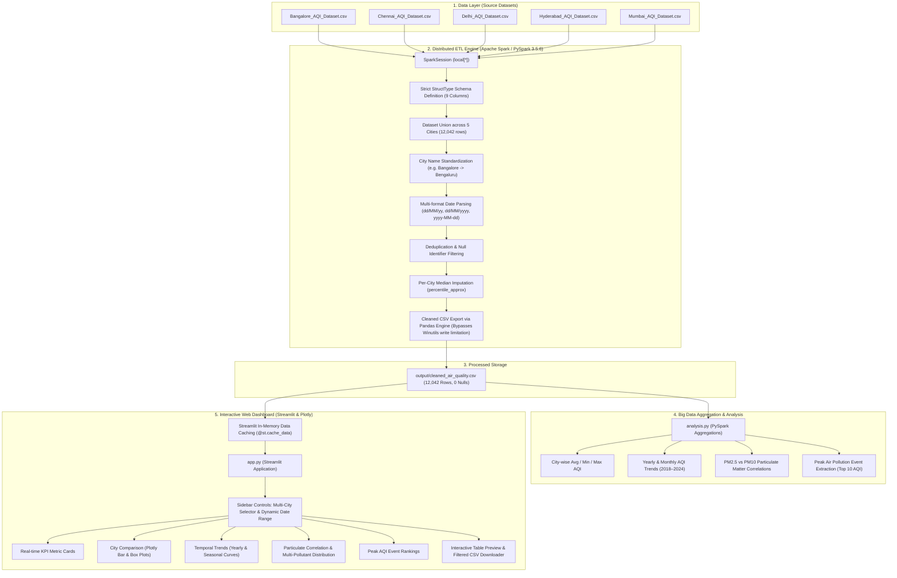

# Architecture & Data Pipeline: Air Quality Analysis

## End-to-End System Architecture

## Architectural Highlights
- **Engine**: Apache Spark 3.5.6 running in local multithreaded mode (`local[*]`).
- **No Hadoop / HDFS Requirement**: Fully standalone on local Windows environments without requiring `winutils.exe` or cluster daemons.
- **Resilient Pipeline**: Fixed schema ingestion isolates trailing commas/columns present in raw files.
- **Fast Caching**: Cleaned data cached in Streamlit for sub-second reactive filter updates.
