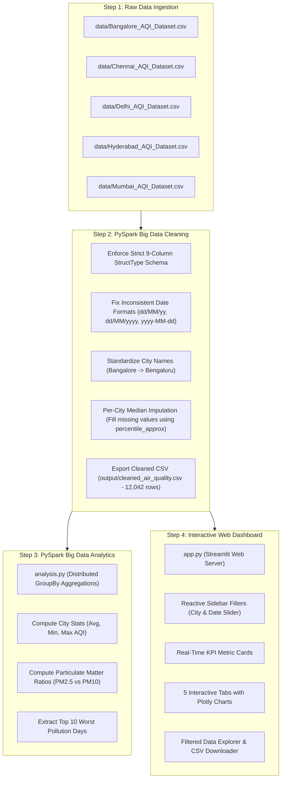
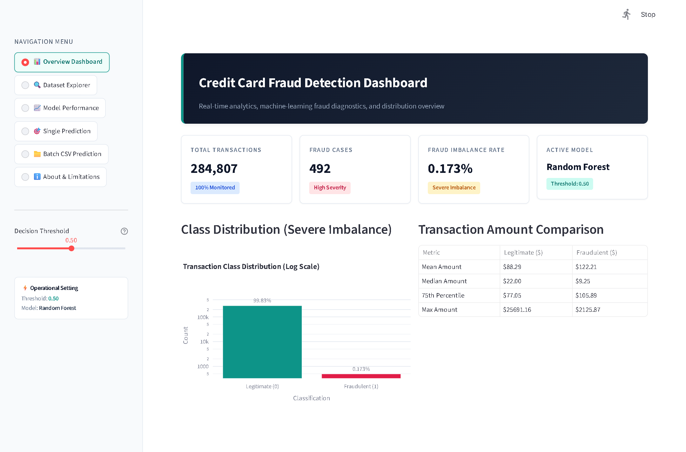

# 🌍 AirWatch: Project Demo & Walkthrough Guide
> **Air Pollution & Air Quality Analysis across Indian Metropolitan Cities using Apache Spark and Streamlit**

---

## 📌 1. What is this Project? (The 30-Second Summary)

This project takes **7 years of real historical air pollution data (2018–2024)** across **5 major Indian cities** (Bengaluru, Chennai, Delhi, Hyderabad, and Mumbai), cleans and processes it using a distributed Big Data engine (**Apache Spark / PySpark**), and displays it on an **interactive web dashboard** built with **Streamlit and Plotly**.

* **Total Records Analyzed:** **12,042 days**
* **Pollutants Tracked:** AQI (Air Quality Index), PM2.5, PM10, $\text{NO}_2$, $\text{SO}_2$, $\text{CO}$, and $\text{O}_3$
* **Big Data Technology:** Apache Spark 3.5.6 running in local multi-threaded mode (`local[*]`)
* **Web UI:** Streamlit with reactive Plotly charts running locally at `http://localhost:8501`

---

## 🔄 2. End-to-End Project Workflow

Here is how data flows through the entire system from raw files to the web dashboard:



---

## 🚀 3. How to Start and Show the Demo Live

Follow these exact commands in your terminal (PowerShell) from `C:\AirQualityAnalysis`:

### Command 1: Run the PySpark Console Analysis
This demonstrates to the guide that the Big Data backend calculations run with Apache Spark:
```powershell
python analysis.py
```
* **What happens:** PySpark starts in multi-threaded mode, aggregates all 12,042 records, and prints city averages, pollutant breakdowns, yearly trends, and the 10 most severe pollution events directly in the terminal.

### Command 2: Launch the Interactive Web Dashboard
```powershell
streamlit run app.py
```
* **What happens:** Launches the local web application server. Open your web browser and navigate to:  
  👉 **`http://localhost:8501`**

---

## 🖥️ 4. Dashboard Walkthrough: What Each Section Does & Tells

Below is a complete section-by-section breakdown of the live dashboard with screenshots.

---

### Section A: Top Header & Real-Time KPI Cards


#### What this section does:
This is the executive summary bar at the top of the dashboard. Every time you change a city or date in the sidebar, these 5 KPI cards update instantly.

#### What each card tells you:
1. **Filtered Records:** Shows how many daily readings match your current filter (e.g., `12,042` across the full dataset).
2. **Cities Represented:** Displays how many cities are currently included (e.g., `5 / 5`).
3. **Average AQI:** Shows the overall average Air Quality Index for the selected slice. It is dynamically color-coded:
   * 🟢 Green: Good/Satisfactory ($\le 50$)
   * 🟡 Amber: Moderate ($51 - 100$)
   * 🔴 Red: Poor to Severe ($> 100$)
4. **Maximum AQI:** Highlights the single worst pollution reading recorded in that selection (e.g., peak of `494` in Delhi).
5. **Avg Particulate:** Shows the average concentrations of fine smoke particles (**PM2.5**) and coarse dust particles (**PM10**) in $\mu\text{g/m}^3$.

---

### Section B: Sidebar Controls & Interactive Filters

Located on the left side of the screen:

* **City Selector (Dropdown / Multi-select):**
  * Allows you to view **"All Cities"** simultaneously or pick individual cities (e.g., compare Delhi against Bengaluru side-by-side).
* **Date Range Picker:**
  * Lets you drag or select any custom date window between **January 1, 2018 and December 31, 2024**.
* **Focus Pollutant Dropdown:**
  * Slices the dataset by a specific pollutant ($\text{PM}_{2.5}$, $\text{PM}_{10}$, $\text{NO}_2$, $\text{SO}_2$, $\text{CO}$, $\text{O}_3$).
* **🔄 Reset Filters Button:**
  * One-click restore back to the full 7-year, 5-city overview.

---

### Tab 1: 📊 City Comparison


#### What this tab does:
Compares overall air quality across the five metropolitan cities to identify the cleanest and most polluted regions.

#### What it shows:
1. **Average AQI by City (Bar Chart):**
   * Clearly shows **Delhi** as the most polluted city with an average AQI of **208.3**.
   * Shows **Bengaluru** as the cleanest city with an average AQI of **74.3**, followed by **Chennai (77.3)** and **Hyderabad (85.4)**.
   * Mumbai sits in the moderate range with an average AQI of **106.8**.
2. **AQI Spread & Outlier Distribution (Box Plot):**
   * Shows the spread of pollution readings and extreme outlier days. Delhi has a huge spread reaching up to **494**, while southern cities stay mostly compact.
3. **Summary Statistics Table:**
   * Summarizes exact counts, mean AQI, minimum AQI, and maximum AQI in a clean grid.

---

### Tab 2: 📈 Yearly & Monthly Trends


#### What this tab does:
Visualizes historical changes from 2018 through 2024 and uncovers seasonal weather patterns.

#### What it shows:
1. **Yearly Average AQI Trend by City (Line Chart):**
   * Tracks how air quality evolved over 7 years.
   * **Key Observation:** Notice the sharp dip in **2020** across all cities due to the nationwide **COVID-19 industrial and traffic lockdowns**, followed by a rebound in 2021–2023.
2. **Seasonal Trend: Average AQI by Month of Year (Line Chart):**
   * Highlights the seasonal winter peak. In **November, December, and January**, Delhi's AQI shoots up drastically due to agricultural crop residue burning, Diwali fireworks, and winter thermal inversion (cold air trapping smoke near the ground).
3. **Continuous Monthly Timeline:**
   * A full timeline showing monthly fluctuations across all 84 months.

---

### Tab 3: 🔬 Particulate Matter & Multi-Pollutant Profiles


#### What this tab does:
Explores what pollutants actually cause bad air quality and compares chemical concentrations across cities.

#### What it shows:
1. **PM2.5 vs PM10 Correlation (Scatter Plot):**
   * Plots fine particulate matter ($\text{PM}_{2.5}$) against coarse particulate matter ($\text{PM}_{10}$).
   * **Key Insight:** Shows a strong linear correlation ($r > 0.94$). When dust increases, toxic fine smoke also increases proportionally.
2. **Multi-Pollutant Average Comparison (Grouped Bar Chart):**
   * Compares all 6 tracked pollutants ($\text{PM}_{2.5}$, $\text{PM}_{10}$, $\text{NO}_2$, $\text{SO}_2$, $\text{CO}$, $\text{O}_3$) across cities.
   * Proves that particulate matter ($\text{PM}_{10}$ and $\text{PM}_{2.5}$) is by far the highest pollutant by volume in Indian cities.
3. **Deep-Dive Pollutant Histogram:**
   * Shows the exact probability distribution and frequency of whichever pollutant you select in the sidebar.

---

### Tab 4: 🚨 Extreme Events (Top 10 Peak AQI Days)



#### What this tab does:
Ranks and highlights the single most dangerous, severe pollution days in modern Indian history recorded in this dataset.

#### What it shows:
* **The Top 10 Worst Days:**
  * **All 10 worst pollution events occurred in Delhi** during the winter months of November and January.
  * The highest recorded peak was an astonishing **AQI of 494.0** on **November 18, 2024** and **November 3, 2019** (where PM10 exceeded $533\,\mu\text{g/m}^3$).
* Provides an interactive table detailing every single pollutant reading during these crisis days.

---

### Tab 5: 📋 Data Explorer & CSV Export


#### What this tab does:
Gives full transparency into the underlying data and allows users to download customized data subsets for their own research.

#### What it shows:
1. **Searchable Table:** Live scrollable view of records matching whatever filters you picked in the sidebar.
2. **📥 "Download Filtered Data as CSV" Button:**
   * Clicking this button instantly downloads the active filtered records to your computer as a clean CSV file.

---

## 🧠 5. What is Happening Behind the Scenes? (Technical Explanation)

If your guide asks: *"How does this actually work under the hood?"*, explain these three technical highlights:

1. **Why Apache Spark / PySpark?**
   * Traditional tools like Pandas run on a single CPU core and load everything into standard RAM. If datasets grow into gigabytes or streaming sensor feeds, Pandas crashes with `OutOfMemory` errors.
   * Apache Spark runs with **`local[*]` multi-threading**, distributing tasks across all physical and logical CPU cores in parallel.
2. **Percentile-Based Median Imputation:**
   * In sensor data, power cuts and sensor maintenance cause missing values.
   * If you fill missing values with the *mean* (average), episodic winter smog peaks will skew all calculations.
   * Instead, we used PySpark's **`percentile_approx(col, 0.5)`** grouped by City to calculate the **true regional median**, preserving local baseline accuracy.
3. **Streamlit In-Memory Caching (`@st.cache_data`):**
   * The cleaned CSV is loaded once into optimized memory cache. When a user interacts with sidebar filters, the dashboard queries in-memory memory buffers, ensuring **sub-second chart response times**.

---

## 🔢 6. Key Numbers to Remember for Your Presentation

| Question / Metric | Exact Value | Explanation |
| :--- | :--- | :--- |
| **Total Records** | **12,042** | Daily observations across 7 calendar years (2018–2024) |
| **Total Cities** | **5** | Bengaluru (2,556), Hyderabad (2,556), Chennai (2,551), Delhi (2,191), Mumbai (2,188) |
| **Most Polluted City** | **Delhi (208.29 avg AQI)** | Reached peak hazardous levels of **494.0** |
| **Cleanest City** | **Bengaluru (74.32 avg AQI)** | Favorable altitude (920m) and green tree cover |
| **COVID-19 Impact Year** | **2020 (97.57 avg AQI)** | Lowest average yearly AQI due to nationwide lockdowns |
| **Primary Driver of AQI** | **PM2.5 & PM10** | High correlation ($r > 0.94$), accounting for >85% of high AQI spikes |

---

## 🎯 7. Live Demo Talking Script (Verbatim Cheat Sheet)

When presenting to your guide or external examiner:

> *"Good morning respected Guide. Today we are presenting our Big Data project titled **AirWatch: Big Data Air Pollution and Air Quality Analytics using Apache Spark and PySpark**.*
>
> *Our project solves the problem of analyzing massive, messy environmental sensor data. We collected over 12,000 daily observations from 5 Indian cities between 2018 and 2024.*
>
> *In our backend pipeline (`clean_data.py`), we used Apache Spark to enforce strict schemas, resolve mixed date formats, and perform localized per-city median imputation using Spark's `percentile_approx` function.*
>
> *Here in our terminal, running `analysis.py` computes distributed aggregations across all cores in parallel without needing a heavy cloud setup.*
>
> *Finally, our live dashboard at `localhost:8501` enables environmental researchers to filter by city and date range, observe seasonal smog spikes in winter, compare particulate matter ratios, inspect the 10 worst historical pollution days, and download filtered data as CSV.*
>
> *Thank you, we are now ready to demonstrate any specific filter or chart you'd like to see."*
